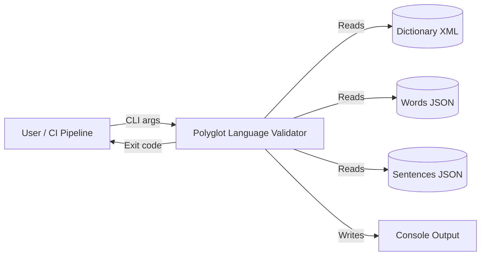
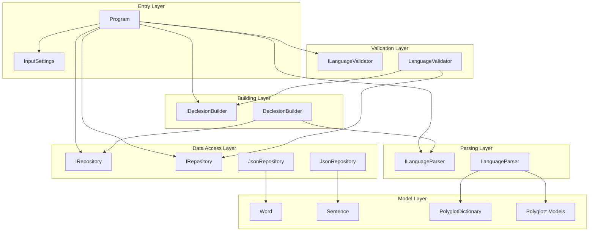
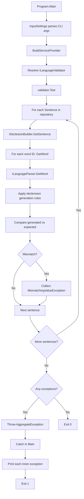
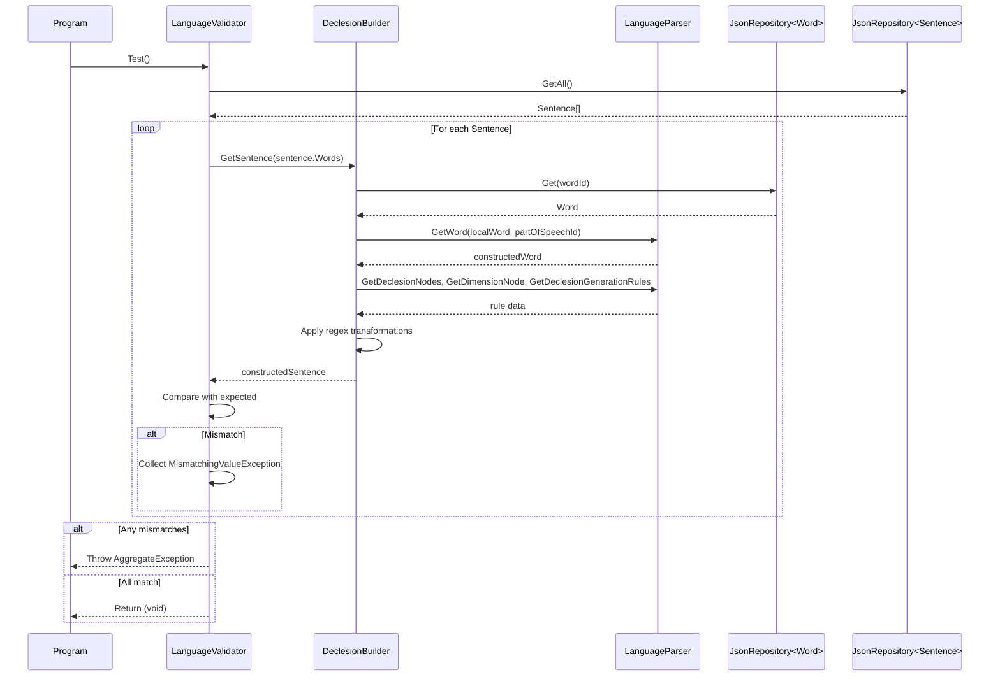
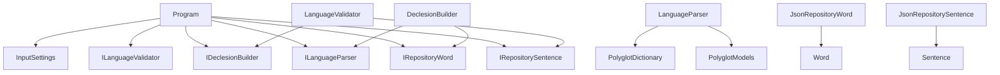

# Polyglot Language Validator Architecture

This document describes the current architecture of the Polyglot Language Validator, a CLI tool that validates constructed language sentences against a Polyglot dictionary.

## 📑 Table of Contents

- [Purpose](#purpose)
- [System Context](#system-context)
- [Architectural Style](#architectural-style)
- [Runtime Flow](#runtime-flow)
- [Components](#components)
- [Architectural Areas](#architectural-areas)
- [Data Architecture](#data-architecture)
- [Interfaces and Integrations](#interfaces-and-integrations)
- [Key Flows](#key-flows)
- [Cross-Cutting Concerns](#cross-cutting-concerns)
- [Dependency Direction and Rules](#dependency-direction-and-rules)
- [External Dependencies](#external-dependencies)
- [Deployment and Operations](#deployment-and-operations)
- [Compatibility Contracts](#compatibility-contracts)
- [Testing and Verification](#testing-and-verification)
- [Design Constraints](#design-constraints)
- [Extension Points](#extension-points)
- [Source Map](#source-map)
- [Related Documentation](#related-documentation)

## 🎯 Purpose

Polyglot Language Validator is a command-line tool that verifies whether generated words and sentences in a constructed language match expected outputs. It loads a Polyglot dictionary (XML), word definitions (JSON), and sentence expectations (JSON), then applies declension and generation rules to validate each sentence. The tool exits with a non-zero status if any validation fails, making it suitable for CI/CD pipelines.

## 🌐 System Context

The system operates as a standalone CLI application with file-based inputs and console output.



The principal external boundaries are:
- **Dictionary XML:** Provides parts of speech, lexicon, declension nodes, and generation rules. Owned by the language author.
- **Words JSON:** Provides local words with part-of-speech and dimension values. Owned by the language author.
- **Sentences JSON:** Provides word-id sequences and expected constructed sentences. Owned by the language author.
- **Console Output:** Emits validation results and errors. Consumed by the user or CI system.

## 🏗️ Architectural Style

The application follows a **layered architecture** with **dependency injection** and **repository pattern**. Layers are organised by responsibility: entry point, validation orchestration, declension building, dictionary parsing, and data access. All dependencies flow inward toward the model layer. Interfaces define service contracts, enabling testability and separation of concerns.



The principal architecture boundaries are:
- **Entry Layer:** CLI parsing, DI composition, process lifecycle. Permitted dependencies: Configuration, Service interfaces, Data Access interfaces.
- **Validation Layer:** Orchestrates sentence validation, collects mismatches. Permitted dependencies: Building Layer, Data Access (Sentence).
- **Building Layer:** Applies declension rules to words, builds sentences. Permitted dependencies: Parsing Layer, Data Access (Word).
- **Parsing Layer:** Loads and deserialises dictionary XML, provides typed lookups. Permitted dependencies: Model Layer (Polyglot*).
- **Data Access Layer:** File I/O for JSON inputs. Permitted dependencies: Model Layer (Word, Sentence).
- **Model Layer:** Data transfer objects, XML/JSON serialisation. No internal dependencies.

## 🔄 Runtime Flow



The principal runtime sequence is:
1. `Program.Main` parses command-line arguments via `InputSettings`
2. `BuildServiceProvider` composes the dependency injection container
3. `ILanguageValidator` is resolved and `Test()` is invoked
4. `LanguageValidator.Test` iterates all sentences from `IRepository<Sentence>`
5. For each sentence, `IDeclesionBuilder.GetSentence` builds the constructed sentence
6. `DeclesionBuilder.GetWord` applies declension rules via `ILanguageParser`
7. Generated sentence is compared to expected; mismatches are collected
8. If any mismatches exist, `AggregateException` is thrown with all failures
9. `Main` catches the exception, prints each error, and exits with code 1

## 🧩 Components

| Component | Responsibility | Principal Dependencies | Lifetime or Ownership |
|-----------|----------------|------------------------|-----------------------|
| `Program` | CLI entry point, DI composition, error handling | `InputSettings`, `ILanguageValidator`, `IServiceProvider` | Singleton (process lifetime) |
| `InputSettings` | Parses and validates CLI arguments | `NuciCLI.Arguments` | Singleton (process lifetime) |
| `LanguageValidator` | Orchestrates sentence validation, collects mismatches | `IDeclesionBuilder`, `IRepository<Sentence>` | Singleton (DI container) |
| `DeclesionBuilder` | Applies declension rules to words, builds sentences | `ILanguageParser`, `IRepository<Word>` | Singleton (DI container) |
| `LanguageParser` | Loads dictionary XML, provides typed lookups | `PolyglotDictionary`, `Polyglot*` models | Singleton (DI container) |
| `JsonRepository<Word>` | Reads words from JSON file | `Word` model, file system | Singleton (DI container) |
| `JsonRepository<Sentence>` | Reads sentences from JSON file | `Sentence` model, file system | Singleton (DI container) |

## 🗂️ Architectural Areas

### Entry Layer

Paths:
- `PolyglotLangageValidator/Program.cs`
- `PolyglotLangageValidator/Configuration/InputSettings.cs`

Responsibilities:
- Parse and validate command-line arguments
- Compose the dependency injection container
- Handle top-level exceptions and exit codes

Boundary rules:
- Must not contain business logic
- Depends only on Configuration, Service interfaces, and Data Access interfaces

### Validation Layer

Paths:
- `PolyglotLangageValidator/Service/LanguageValidator.cs`
- `PolyglotLangageValidator/Service/ILanguageValidator.cs`

Responsibilities:
- Iterate sentences from repository
- Delegate sentence building to `IDeclesionBuilder`
- Collect and aggregate mismatches

Boundary rules:
- Must not directly access dictionary or word data
- Depends on Building Layer and Data Access (Sentence only)

### Building Layer

Paths:
- `PolyglotLangageValidator/Service/DeclesionBuilder.cs`
- `PolyglotLangageValidator/Service/IDeclesionBuilder.cs`

Responsibilities:
- Build constructed words by applying declension rules
- Build sentences from word IDs
- Coordinate rule lookup and application

Boundary rules:
- Must not directly load or parse dictionary XML
- Depends on Parsing Layer and Data Access (Word only)

### Parsing Layer

Paths:
- `PolyglotLangageValidator/Service/LanguageParser.cs`
- `PolyglotLangageValidator/Service/ILanguageParser.cs`
- `PolyglotLangageValidator/Models/Polyglot/`

Responsibilities:
- Load and deserialise Polyglot dictionary XML
- Provide lookup methods for parts of speech, declension nodes, dimensions, generation rules

Boundary rules:
- Must not contain validation or building logic
- Depends only on Model Layer (Polyglot*)

### Data Access Layer

Paths:
- External: `NuciDAL.Repositories.JsonRepository<T>`

Responsibilities:
- Read `Word` and `Sentence` objects from JSON files
- Implement `IRepository<T>` contract

Boundary rules:
- Generic, reusable across entity types
- No business logic

### Model Layer

Paths:
- `PolyglotLangageValidator/Models/Word.cs`
- `PolyglotLangageValidator/Models/Sentence.cs`
- `PolyglotLangageValidator/Models/Polyglot/*.cs`

Responsibilities:
- Data transfer objects for JSON serialisation
- XML-serialisable dictionary models
- Base entity with identifier

Boundary rules:
- No dependencies on other layers
- Pure data containers

## 💾 Data Architecture

```mermaid
flowchart LR
    DictXML[(Dictionary XML)] -->|XmlSerializer| PolyglotDict[PolyglotDictionary]
    WordsJSON[(Words JSON)] -->|JsonRepository| WordObjs[Word[]]
    SentencesJSON[(Sentences JSON)] -->|JsonRepository| SentenceObjs[Sentence[]]

    PolyglotDict --> LangParser[LanguageParser]
    WordObjs --> DeclBuilder[DeclesionBuilder]
    SentenceObjs --> LangValidator[LanguageValidator]

    LangParser --> DeclBuilder
    DeclBuilder --> LangValidator
```

| Data or Store | Owner | Representation and Storage | Lifecycle or Consistency |
|---------------|-------|----------------------------|--------------------------|
| `PolyglotDictionary` | `LanguageParser` | In-memory object graph from XML deserialisation | Loaded once at startup; immutable for process lifetime |
| `Word[]` | `JsonRepository<Word>` | In-memory list from JSON deserialisation | Loaded once at startup; read-only during validation |
| `Sentence[]` | `JsonRepository<Sentence>` | In-memory list from JSON deserialisation | Loaded once at startup; read-only during validation |
| `MismatchingValueException` | `LanguageValidator` | In-memory collection | Created during validation; thrown as `AggregateException` |

## 🔌 Interfaces and Integrations

| Interface or Integration | Direction | Contract | Owner | Failure Semantics |
|--------------------------|-----------|----------|-------|-------------------|
| `ILanguageValidator` | Inbound (DI) | `void Test()` | `LanguageValidator` | Throws `AggregateException` on mismatch |
| `IDeclesionBuilder` | Inbound (DI) | `string GetWord(Word)`, `string GetSentence(params string[])` | `DeclesionBuilder` | Propagates exceptions from parser/repository |
| `ILanguageParser` | Inbound (DI) | Lookup methods for dictionary data | `LanguageParser` | Throws on missing data (e.g., `First()` on empty) |
| `IRepository<Word>` | Inbound (DI) | `T Get(string id)`, `IEnumerable<T> GetAll()` | `JsonRepository<Word>` | Throws on file/deserialisation error |
| `IRepository<Sentence>` | Inbound (DI) | `T Get(string id)`, `IEnumerable<T> GetAll()` | `JsonRepository<Sentence>` | Throws on file/deserialisation error |
| Dictionary XML | Inbound (file) | `PolyglotDictionary` XML schema | `LanguageParser` | Throws `InvalidOperationException` on deserialisation failure |
| Words JSON | Inbound (file) | `Word[]` JSON array | `JsonRepository<Word>` | Throws on file/deserialisation error |
| Sentences JSON | Inbound (file) | `Sentence[]` JSON array | `JsonRepository<Sentence>` | Throws on file/deserialisation error |
| Console | Outbound | Text output, exit code | `Program` | N/A |

## 🔀 Key Flows

### Sentence Validation Flow



Ordering and invariants:
- Sentences are validated in repository order (file order)
- Each word in a sentence is processed sequentially
- All matching generation rules are applied in index order
- Validation stops only after all sentences are checked; all mismatches are reported together

## 🧵 Cross-Cutting Concerns

### Error Handling

- Failures originate from: file I/O (missing/invalid input files), XML/JSON deserialisation, missing dictionary data (e.g., part of speech not found), regex processing
- `LanguageValidator` aggregates all sentence mismatches into a single `AggregateException`
- `Program.Main` catches `AggregateException`, prints each inner exception message, and exits with code 1
- Other exceptions (file not found, deserialisation) propagate to `Main` and cause process termination with unhandled exception output

### Configuration

| Configuration Area | Source | Responsibility | Override or Secret Policy |
|--------------------|--------|----------------|---------------------------|
| Dictionary file path | CLI argument (`--dictionary`/`-d`) | Required input | No override; mandatory |
| Words file path | CLI argument (`--words`/`-w`) | Required input | No override; mandatory |
| Sentences file path | CLI argument (`--sentences`/`-s`) | Required input | No override; mandatory |

All configuration is provided via command-line arguments parsed by `NuciCLI.Arguments`. No environment variables, configuration files, or secrets are used.

### Concurrency and Resource Use

- Single-threaded execution; no parallelism
- All input data loaded into memory at startup
- No shared mutable state during validation
- File handles opened and closed per repository operation
- Practical capacity limited by available memory for input files

## 🧭 Dependency Direction and Rules



The principal dependency rules are:
- Dependencies flow inward: Entry → Validation → Building → Parsing → Models
- Data Access depends only on Models
- No layer may depend on a layer further from Models
- Interfaces are defined in the same project as their implementations (no separate interface assembly)
- External dependencies (NuciCLI, NuciDAL, Microsoft.Extensions.DI) are used only at composition root and in Data Access

## 📦 External Dependencies

| Dependency | Responsibility | Integration Boundary | Architectural Consequence |
|------------|----------------|----------------------|---------------------------|
| `Microsoft.Extensions.DependencyInjection` | DI container | `Program.BuildServiceProvider` | Centralised composition; enables interface-based design |
| `NuciCLI.Arguments` | CLI argument parsing | `InputSettings` constructor | Declarative argument binding; validation built-in |
| `NuciDAL` | Repository abstraction, JSON repository | `JsonRepository<T>` in DI registration | Generic data access; decouples validation from file format |
| `System.Text.RegularExpressions` | Regex matching and replacement | `DeclesionBuilder.GetWord` | Core transformation engine; no abstraction |

## 🚀 Deployment and Operations

| Concern | Current Design | Architectural Consequence |
|---------|----------------|---------------------------|
| Process topology | Single-process CLI executable | No service dependencies; runs anywhere .NET 10.0 is available |
| Deployment unit | Self-contained or framework-dependent .NET executable | Simple distribution; no installer required |
| Persistent state | None (stateless per invocation) | No database, cache, or local storage between runs |
| Filesystem requirements | Read access to three input files | Input paths provided at runtime; no fixed locations |
| Network requirements | None | Fully offline operation |
| Scaling assumptions | Single-threaded; memory-bound | Not designed for horizontal scaling; large inputs limited by RAM |
| Startup responsibilities | Load all input files, compose DI | Startup time proportional to input file sizes |
| Shutdown responsibilities | None (process exit) | No cleanup required |
| Operator-visible outputs | Console text (mismatches), exit code (0/1) | CI-friendly; parseable output |

## 🛡️ Compatibility Contracts

| Contract | Owner | Invariant | Verification | Change Policy |
|----------|-------|-----------|--------------|---------------|
| CLI argument names (`--dictionary`, `--words`, `--sentences`) | `InputSettings` | Names and aliases stable | Manual testing | Breaking change requires major version |
| Exit codes (0 = success, 1 = validation failure) | `Program` | Only 0 or 1 returned | Unit tests | Breaking change requires major version |
| Dictionary XML schema | `PolyglotDictionary` models | XML element/attribute names stable | Deserialisation tests | Additive only; new elements optional |
| Words JSON schema | `Word` model | Property names stable | Deserialisation tests | Additive only; new properties optional |
| Sentences JSON schema | `Sentence` model | Property names stable | Deserialisation tests | Additive only; new properties optional |

## ✅ Testing and Verification

The solution includes a unit test project (`PolyglotLanguageValidator.UnitTests`) using NUnit 4.x and Moq.

Test boundaries:
- `InputSettingsTests`: CLI argument parsing and validation
- `MismatchingValueExceptionTests`: Exception construction and properties
- `DeclesionBuilderTests`: Word and sentence building logic with mocked dependencies
- `LanguageParserTests`: Dictionary loading and lookup methods with mocked XML
- `LanguageValidatorTests`: Validation orchestration and mismatch aggregation

Execute the principal automated verification with:

```bash
dotnet test PolyglotLanguageValidator.UnitTests/PolyglotLanguageValidator.UnitTests.csproj
```

Build verification:

```bash
dotnet build PolyglotLangageValidator/PolyglotLangageValidator.csproj
```

Material coverage gaps:
- No integration tests for end-to-end file processing
- No tests for malformed input file handling
- No performance or memory benchmarks

## ⚠️ Design Constraints

- **Single-threaded execution:** No parallelism; validation is sequential. Limits throughput for large datasets.
- **In-memory loading:** All input files loaded entirely into memory. Large dictionaries or word lists may cause memory pressure.
- **No streaming:** JSON and XML deserialisation require complete documents. Cannot process incrementally.
- **Regex-based transformations:** Generation rules use .NET regex; complex rules may have performance implications.
- **Fail-fast on deserialisation:** Invalid input files cause immediate process termination rather than graceful degradation.
- **No partial validation:** All sentences are validated even after first mismatch; no early-exit option.
- **Fixed input formats:** Only Polyglot XML and specific JSON schemas supported; no pluggable parsers.

## 🔧 Extension Points

### Custom Repository Implementation

1. Implement `IRepository<T>` for `Word` or `Sentence`
2. Register the implementation in `Program.BuildServiceProvider` instead of `JsonRepository<T>`
3. Add tests to verify the new repository preserves `Get` and `GetAll` contracts

The extension must preserve:
- `Get(string id)` returns entity by identifier
- `GetAll()` returns all entities in deterministic order
- Thread-safety not required (single-threaded use)

### Custom Dictionary Format

1. Create new model classes for the format
2. Implement `ILanguageParser` with the new loading logic
3. Register the implementation in `Program.BuildServiceProvider`
4. Ensure all lookup methods (`GetWord`, `GetPartOfSpeech`, etc.) return equivalent data

The extension must preserve:
- All `ILanguageParser` method signatures and return types
- Case-sensitive matching behaviour
- Exception behaviour for missing data

## 🗺️ Source Map

| Area | Path |
|------|------|
| Entry Point | `PolyglotLangageValidator/Program.cs` |
| Configuration | `PolyglotLangageValidator/Configuration/InputSettings.cs` |
| Validation Layer | `PolyglotLangageValidator/Service/LanguageValidator.cs` |
| Validation Interface | `PolyglotLangageValidator/Service/ILanguageValidator.cs` |
| Building Layer | `PolyglotLangageValidator/Service/DeclesionBuilder.cs` |
| Building Interface | `PolyglotLangageValidator/Service/IDeclesionBuilder.cs` |
| Parsing Layer | `PolyglotLangageValidator/Service/LanguageParser.cs` |
| Parsing Interface | `PolyglotLangageValidator/Service/ILanguageParser.cs` |
| Domain Models | `PolyglotLangageValidator/Models/Word.cs`, `Sentence.cs` |
| Polyglot Models | `PolyglotLangageValidator/Models/Polyglot/*.cs` |
| Exceptions | `PolyglotLangageValidator/Exceptions/MismatchingValueException.cs` |
| Unit Tests | `PolyglotLanguageValidator.UnitTests/` |
| Documentation | `docs/` |

## 📚 Related Documentation

- [README.md](./README.md) — Project overview, usage, and CLI reference
- [CONTRIBUTING.md](./CONTRIBUTING.md) — Contribution guidelines
- [SECURITY.md](./SECURITY.md) — Security policy and vulnerability reporting
- [PRIVACY.md](./PRIVACY.md) — Data handling and privacy
- [docs/architecture.md](./docs/architecture.md) — Supplementary architecture notes
- [docs/data-model.md](./docs/data-model.md) — Data model details
- [docs/dependencies.md](./docs/dependencies.md) — Dependency inventory
- [docs/testing.md](./docs/testing.md) — Testing strategy